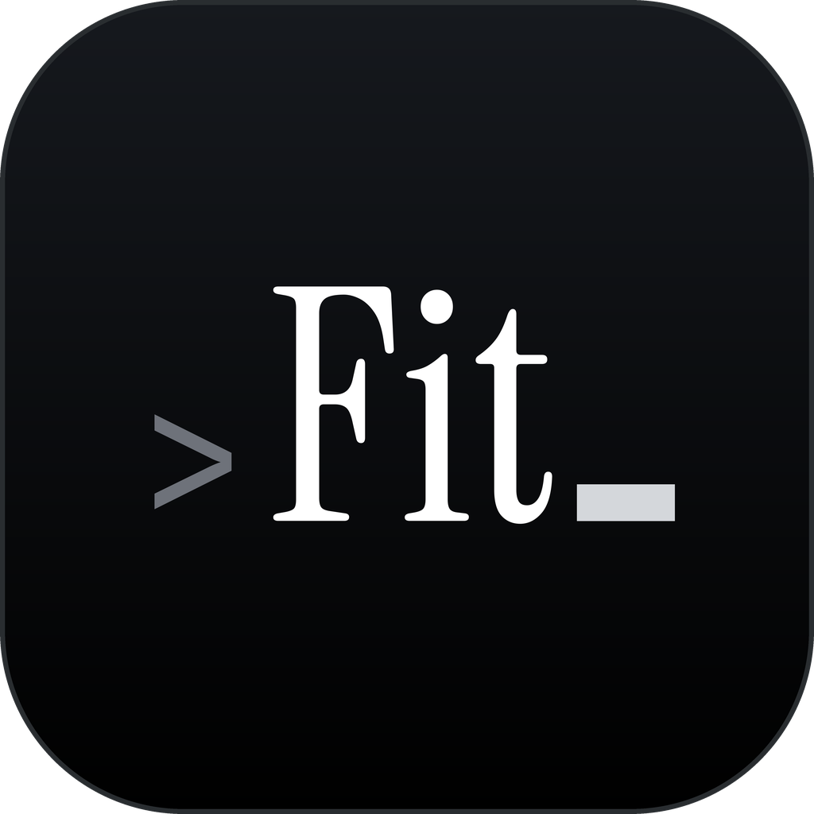

<div align="center">



# FitCom

**Your group's own hangout: chat, voice, screen sharing and files, peer to peer.**
<br>
No accounts. No servers. Just you and the people you trust.

[](https://github.com/PieWhite/FitCom/releases)


[](LICENSE)

[**Download**](https://github.com/PieWhite/FitCom/releases) · [Features](#features) · [Connect](#connect-in-60-seconds) · [Build](#build-from-source) · [Docs](#documentation)

</div>

---

FitCom is a native desktop app for small groups, written in Rust and drawn on the GPU
with [GPUI](https://www.gpui.rs/). Every peer connects straight to every other peer in a
full mesh. There's no host, no FitCom account, no central chat server, and no signaling,
STUN or TURN service. Each machine keeps its own identity, settings and history, and
peers sync with each other whenever they reconnect.

```
        ┌──────────┐
        │  Alice   │
        └──┬────┬──┘        no server in the middle:
   QUIC+TLS│    │           every peer talks to every peer,
  ┌────────┴┐  ┌┴────────┐  and history syncs when they reconnect
  │   Bob   ├──┤  Carol  │
  └─────────┘  └─────────┘
```

> [!WARNING]
> **Experimental software, for people you trust.** Connections authenticate peers and
> media is encrypted, but relayed public-channel operations are not individually signed.
> A malicious peer you've admitted can forge another author's messages and edits. Don't use
> FitCom with hostile participants or where you need strong authorship guarantees. See the
> [security policy](SECURITY.md), [audit](docs/SECURITY-AUDIT.md) and
> [remediation plan](docs/SECURITY-REMEDIATION.md).

## Features

### 💬 Chat that lives on your machines
- **Channels and direct messages** with persistent history that syncs whenever peers reconnect, including to someone who was offline for days.
- **Replies, reactions, edits, deletes** and **pinned messages**.
- **`@mentions`** with highlighting and system notifications.
- **Channel search** and **jump to latest**.
- **Rich text and markup**, **profile pictures** and nicknames.
- **YouTube previews**: title and thumbnail for links pasted in chat.

### 🎙️ Voice
- **Opus** voice with a jitter buffer and **noise suppression**.
- **Push-to-talk** or **push-to-mute**, plus an adjustable **mic threshold**.
- **Per-peer volume**, deafen, and a click-through **voice overlay** that lights up whoever's talking, even over a fullscreen game.
- **"Playing X"** next to your name, detected locally from your fullscreen game. No game database needed.

### 🖥️ Screen sharing
- Share a **screen with desktop audio**, GPU-encoded (Media Foundation on Windows, VideoToolbox on macOS).
- **Draw on a shared screen**: annotations show on the viewer's window and on the sharer's monitor.
- **Remote control** (Windows): a viewer can drive mouse and keyboard and share the clipboard, only once the sharer approves it locally.
- **Camera broadcasting** on Windows. macOS can watch Windows camera streams.
- **Share Spotify**: stream just Spotify's audio, with the current "Artist – Track" as the stream title. Read locally, with no Spotify account or API.

### 🎬 Clips (Windows)
- Always-on **replay buffer** of your screen and game audio, from 30 seconds up to 2 hours.
- Save the last N minutes with a **global hotkey**. You choose the screen, frame rate, resolution and quality, and every option shows its disk cost.

### 📁 Files
- **Drag, drop or paste** files into chat. The offer syncs to everyone like a message, and peers download the bytes directly from you.

### 🟩 Daily Wordle and 📊 Recap
- Play **today's Wordle** together inside the app, with result cards in chat and a scoreboard covering every day, solo days included.
- **Recap**: a weekly look at time in calls, time sharing, messages, files and Wordle points for each peer, counted on your own machine.

### ⚙️ Little things that matter
- **Invite codes** (`fitcom1:…`), with automatic router port mapping (UPnP / PCP / NAT-PMP).
- **Self-healing mesh**: peers remember where they last saw each other, and learn new IPs from a third peer.
- **Signed auto-updates** on Windows (Ed25519 + BLAKE3).
- **Tray icon**, optional **autostart** and **portable mode** on Windows.

## Download

Grab the latest build from [**Releases**](https://github.com/PieWhite/FitCom/releases).

<details open>
<summary><b>🪟 Windows 11</b></summary>

Extract into a folder your user account owns, keep `fitcom.exe` and `fitcom-updater.exe`
together, and launch `fitcom.exe`.

- **Portable mode:** an empty `data` folder next to the exe keeps everything there. Otherwise FitCom uses the OS application-data directory.
- Existing installations keep their old data location, identity, settings and chat.
- Update-manifest signatures are separate from Windows Authenticode. Publisher signing is not currently configured.
</details>

<details>
<summary><b>🍎 macOS 14+ (Apple Silicon)</b></summary>

Extract `FitCom.app`. Bundles are ad-hoc signed, not signed with an Apple Developer ID or
notarized, so macOS may ask for explicit approval and for microphone and screen-recording
permissions. Updates are manual. Camera broadcasting, clips and autostart are
Windows-only.
</details>

Linux is not supported.

## Connect in 60 seconds

1. Open **Settings → Network** and copy your invite code (`fitcom1:…`).
2. Send it to your friend over a channel where you can verify it's really them.
3. Each of you pastes the other's code under **Add peers**. That's it.

Codes contain your public identity key, display name and network addresses, so treat them
as personal information. A code alone doesn't authorize a connection: both sides have to
admit each other.

| Port    | Purpose |
|---------|---------|
| `41650` | control (QUIC) |
| `41651` | media |

FitCom asks your router for port mappings when that's enabled. Some CGNAT or firewall
setups prevent direct connections, and there is no hosted relay fallback. Allow the app
only on networks you trust, and never disable your firewall to troubleshoot.

## Build from source

**Requirements:** Rust **1.97+**, CMake, and platform tools.

- **Windows:** MSVC toolchain, Visual Studio C++ Build Tools, Windows SDK (`fxc.exe`).
- **macOS:** Xcode command-line tools and `brew install cmake`.

```sh
cargo build --locked --release -p fitcom --bins
```

Windows binaries land in `target/release/`. Distribute release builds together with the
updater, because debug builds can depend on shader sources from the build machine.

```sh
bash scripts/bundle-mac.sh   # macOS bundle → target/bundle/
```

### Workspace

| Crate | What it does |
|-------|--------------|
| `crates/app`   | The app: engine, GPUI interface, tray, updater, release tool |
| `crates/net`   | QUIC full mesh, framing, media-path encryption, port mapping |
| `crates/proto` | Wire protocol, ops and invite codes |
| `crates/store` | Local SQLite op-log and sync |
| `crates/audio` | Capture, Opus, jitter buffer, mixing, push-to-talk |
| `crates/video` | Screen and camera capture, encoding, viewer, drawing, remote control |

### Development

```sh
cargo fmt --all -- --check
cargo test --locked --workspace --lib
cargo test --locked -p fitcom-proto -p fitcom-store -p fitcom-net
cargo deny check -W unmaintained
```

Hardware tests need real devices and an interactive desktop. See [testing](docs/TESTING.md)
and [contributing](CONTRIBUTING.md). Use a separate `--data-dir` and non-production ports
for each local instance.

## Updates

Windows checks a public HTTPS manifest about a minute after startup, then every six hours,
or whenever you click **Check for updates**. Installed apps use no GitHub login, token or
API key. The manifest is a release asset, not a GitHub REST API call, but GitHub still sees
normal download metadata and can apply availability or abuse limits.

An update needs an embedded Ed25519 public key, a signed version, size and BLAKE3 hash, a
verified payload, and your confirmation. The updater checks the hash again before it
replaces anything. Keep the private signing key outside the repository and archives.

A migration release is also offered through the previous release source, so existing
clients can switch to FitCom. The original repository stays public until its owner
explicitly approves making it private after users migrate. See the
[release procedure](docs/RELEASING.md).

## Documentation

| | |
|---|---|
| 🏗️ [Architecture](docs/ARCHITECTURE.md) | 🔒 [Privacy and local data](docs/PRIVACY.md) |
| 🛡️ [Security policy](SECURITY.md) · [Audit](docs/SECURITY-AUDIT.md) | 🤝 [Contributing](CONTRIBUTING.md) |
| 🧪 [Testing](docs/TESTING.md) · [Validation](docs/VALIDATION.md) | 🚀 [Releasing](docs/RELEASING.md) |
| 📜 [Third-party notices](THIRD_PARTY_NOTICES.md) | |

## License

Project code is **GPL-3.0-only**, see [LICENSE](LICENSE). Dependencies keep their own
licenses. Licensing for the bundled Wordle word list is unverified, and the list is not
represented as covered by the project's GPL grant. See
[third-party notices](THIRD_PARTY_NOTICES.md).

<div align="center"><sub>Built with 🦀 for friends who'd rather not hand their group chat to a server.</sub></div>
